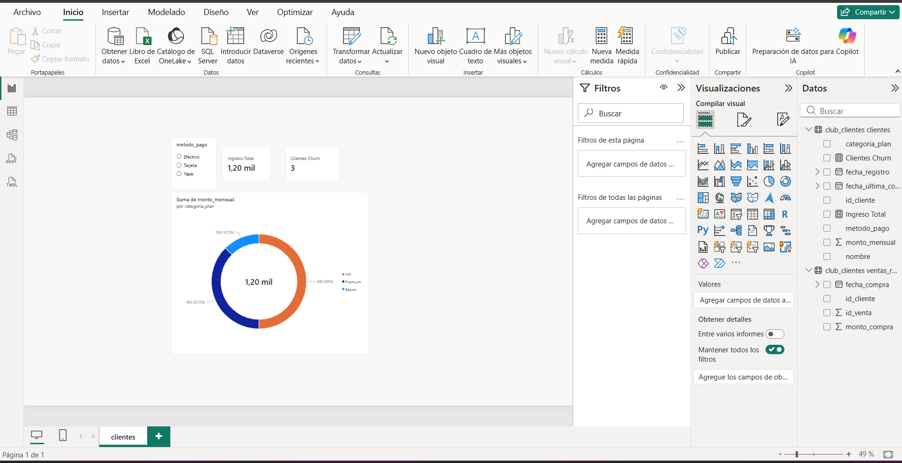

# 📊 Análisis de Retención y Churn de Clientes en MySQL

## 🎯 Objetivo del Proyecto
Identificar el porcentaje de inactividad de los clientes (Churn) en una plataforma de suscripciones, evaluando el impacto económico en los ingresos mensuales de la empresa para tomar decisiones estratégicas de fidelización.

---

## 🛠️ Herramientas Utilizadas
- **Base de Datos:** MySQL
- **Funciones Clave:** `DATEDIFF`, `IF`, `SUM`, `COUNT`, `AVG`, `ROUND`, `GROUP BY`, `INNER JOIN`
- **Dashboard / Visualización:** Looker Studio / Google Sheets

---

## 💻 Script de Base de Datos y Consultas

###  Creación de la Estructura de Datos y consulta de clasificación de clientes y churn
```sql
CREATE DATABASE IF NOT EXISTS club_clientes;
USE club_clientes;

CREATE TABLE IF NOT EXISTS clientes (
    id_cliente INT PRIMARY KEY,
    nombre VARCHAR(50),
    categoria_plan VARCHAR(20),
    monto_mensual DECIMAL(10,2),
    fecha_registro DATE,
    fecha_ultima_compra DATE,
    metodo_pago VARCHAR(20)
);


SELECT 
    IF(DATEDIFF('2026-10-15', fecha_ultima_compra) > 90, 'Inactivo (Churn)', 'Activo') AS estado_cliente,
    COUNT(id_cliente) AS total_clientes,
    SUM(monto_mensual) AS ingreso_mensual_total,
    ROUND(AVG(monto_mensual), 2) AS ticket_promedio
FROM clientes
GROUP BY estado_cliente;


## 📊 Dashboard de Ventas y Churn en Power BI

Se conectó la base de datos MySQL `club_clientes` directamente a Power BI Desktop para modelar métricas con DAX y construir un tablero interactivo.




